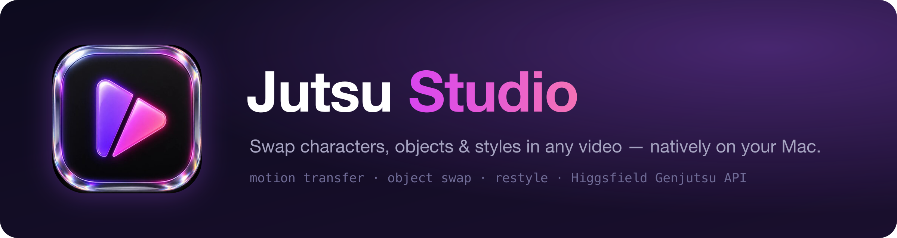
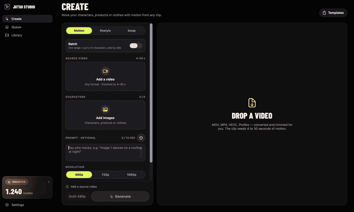

<div align="center">



**The unofficial open-source Mac app for Higgsfield.**
Make video and images with Genjutsu, Seedance, Kling and Higgsfield's other models in a native studio, and keep every file on your disk.

[Download for macOS](https://github.com/jutsuhq/jutsu-studio/releases/latest) · [Quick start](#-quick-start) · [Features](docs/features.md)

[](LICENSE)
[](#-quick-start)
[](https://developer.apple.com/xcode/swiftui/)
[](#-contributing)
[](#%EF%B8%8F-disclaimer)

</div>

---

## 🎬 Demo



*Motion transfer with a location reference: drop the clip, add the image, write the prompt, generate. The queue shows each step, the result opens next to the source with a draggable before/after divider, and Compare plays two takes of the same clip side by side. [Full 53-second demo (MP4)](docs/assets/demo.mp4)*

## 💡 Why Jutsu Studio

Higgsfield's web app is made for one generation at a time in a browser tab. Jutsu Studio is a native Mac app made for working through a project: many clips, many takes, and a library you keep.

- **Your files, on your disk.** Every result is downloaded to `~/Movies/Jutsu Studio/Videos` as soon as it's ready, with its source, references, prompt and cost. Higgsfield's links expire; your library doesn't, and it opens offline.
- **Any video, straight from Finder.** Drop a MOV, HEVC or ProRes file, or paste a link. The app transcodes and trims it on your Mac and uploads only the range you pick, so you never pay for seconds you cut.
- **Close the window, not the work.** Queue as many jobs as you like. They keep running in the background, show in the menu bar, notify you when they're done, and pick up again after a restart or a dropped connection, without ever paying twice.
- **Built for many takes.** Cut several ranges from one clip in one go, make cheap 480p drafts before the final, compare takes side by side, and keep a character, preset and prompt as a template.
- **The price before the click.** Every button shows what the job costs, and an optional daily cap guards your budget.
- **Straight into your editor.** One click exports ProRes 422 or H.264 for Premiere Pro, DaVinci Resolve or Final Cut Pro, with take names that sort in order.
- **Nothing in between.** No Jutsu server, no account of ours, no markup, no telemetry. The app talks to Higgsfield directly with your API key or your Higgsfield sign-in and keeps the credentials in the macOS Keychain.

## ✨ What it does

- **Genjutsu:** motion transfer, object swap and restyle of any video.
- **Seedance 2.5:** motion transfer, a clip from a prompt and images alone, start and end frames, and Edit or Extend of an existing video.
- **Kling 3.0 Motion Control** and, with an API key, **Kling O3** video reference.
- **Kling O3 Edit**, **Wan 3.0** and **Wan 3.0 Prime**, and **Cinema Studio 4.0**; with an API key also **Kling 2.6 Motion Control** and **Wan 2.7**.
- **On a Higgsfield account:** Upscale, Reframe, Remove Background, Dub and Change Voice for a result; the Motion Library; your reference elements; your plan's unlimited generations.

**[See every feature →](docs/features.md)**

## 🚀 Quick Start

**1. Install** — with [Homebrew](https://brew.sh):

```bash
brew install jutsuhq/tap/jutsu-studio
```

or grab `Jutsu-Studio-<version>.dmg` from the [latest release](https://github.com/jutsuhq/jutsu-studio/releases/latest), open it and drag Jutsu Studio to Applications. *(macOS 14 Sonoma or later, Apple silicon and Intel.)*

**2. Connect Higgsfield** — either **Connect your Higgsfield account** to spend your plan's credits (OAuth in your browser through Higgsfield's MCP server; the app never sees your password), or paste an API key from the [Higgsfield console](https://console.higgsfield.ai) to pay as you go. Tokens and keys live in your macOS Keychain. Generations are billed to **your own Higgsfield account**; Jutsu Studio is free and takes no cut.

**3. Drop a video** — pick a 4–30 s range, add a character image (or choose a restyle preset), check the price tag and hit **Draft 480p**. A couple of minutes later the result is in your library and in `~/Movies/Jutsu Studio/Videos`.

## 🔒 Privacy & safety

- No backend, no accounts of ours, no telemetry — the app talks straight to `api.higgsfield.ai` / `mcp.higgsfield.ai` with your key or sign-in, and to `github.com` for updates.
- Bring your own account: no key ships with the app. Your own API key or sign-in tokens are stored only in the macOS Keychain; logs redact credentials and signed URLs.
- Generation runs on Higgsfield's servers, not on your Mac. The source video, any reference images and the prompt are uploaded to Higgsfield for each job, and the results are downloaded back.
- Your library, history and settings stay on your machine (a local SwiftData store and your Movies folder).
- Open source under MIT — audit every line yourself.
- Found a vulnerability? Report it privately as described in [SECURITY.md](SECURITY.md).

## 🤝 Contributing

Issues and PRs are welcome. Read [CONTRIBUTING.md](CONTRIBUTING.md) for setup, lint and code rules and [ARCHITECTURE.md](ARCHITECTURE.md) for how the app is put together, and keep the app's principles: bring-your-own-account, local-first, never surprise with cost.

## ⚠️ Disclaimer

Jutsu Studio is an **unofficial, community-built tool**. It is not affiliated with, endorsed by, or connected to Higgsfield AI in any way. Higgsfield, Genjutsu, Seedance, Kling and other model names are trademarks of their respective owners. All generation costs are billed to your own Higgsfield account at list prices.

## Credits

- [Barlow Condensed](https://github.com/jpt/barlow) by The Barlow Project Authors, used unmodified under the [SIL Open Font License 1.1](JutsuStudio/Resources/Fonts/OFL.txt).
- [Sparkle](https://sparkle-project.org) for Software Update, under the [MIT License](JutsuStudio/Resources/Licenses/Sparkle.txt).

## License

[MIT](LICENSE) © Jutsu Studio contributors
